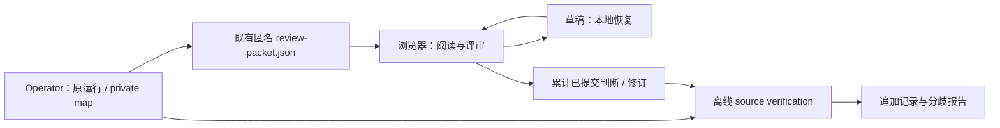

# RC-005 · 离线语义评审台

**状态：** 已实现的固定研究评审工具，使用 [development worksheet](../continuity-review-calibration.md)；不是 accepted rubric、自动 scorer、已完成人类校准或公开系统结果。只支持既有 RC-005 native 匿名包的首次 blind pass，以及明确标记的作者练习包。

## 中文摘要

打开本目录的 [`index.html`](index.html)，选择匿名 `review-packet.json`，按完整历史和原样回答记录字句、归属、证据、行动、澄清、选择性使用与条件可猜测性。可保存未完成草稿、继续长批次、暂跳过再回来、修订已提交判断并保留旧版本。下载判断交回 operator 后，由离线 CLI 验证原运行与源包，追加导入并生成保留分歧的报告。

## English summary

This standalone offline desk supports the existing RC-005 first-blind-pass handoff. Reviewers inspect governing history, the current turn and exact responses, record claims and distinct judgments, resume drafts and preserve amendments. The operator verifies native-source binding, imports cumulative submissions and produces descriptive reports. It runs no system or provider and establishes no validated rubric, accuracy, ranking or human calibration.

## 先用公开练习走完整流程

无需 server、账号或网络。在浏览器直接打开 `index.html`，点击「先用合成练习包试一遍」。七条作者编写的回答覆盖提案、声称已完成的工作、空字符串与技术失败；它们是操作练习，不是系统输出。练习包、草稿、判断和报告始终带 `practice_only: true`。

1. 填 reviewer alias。添加需要检查的原文字句，区分事实、提议、问题、承诺与歧义；H1… 对应包中有序历史，`current` 对应当前问题。
2. 分别记录支持、行动、澄清、使用与限制。条件猜测单独记录；无法判断可以明确保留，不能把猜测当成已知条件。
3. 「暂时跳过」保留已有草稿；「下载草稿」保存整个评审进度、未完成编辑、提交与修订历史。重新打开相同包后，用「恢复草稿」继续。
4. 「提交这条判断」在工作区定稿。要改变已提交判断，选择「修订」，写明理由；旧判断继续保留。下载「已提交判断」得到累计 journal，包含先前版本。没有提交的草稿或跳过项不作为判断导出。

从 repo root 验证浏览器实际下载的判断文件：

```bash
python3 -B tools/rc005_review.py prepare-practice \
  --packet case-lab/reviews/workbench/demo.json \
  --output experiments/artifacts/rc005-review-practice
python3 -B tools/rc005_review.py import-review \
  --workspace experiments/artifacts/rc005-review-practice \
  --input /path/to/rc005-review-judgments.json
python3 -B tools/rc005_review.py verify \
  --workspace experiments/artifacts/rc005-review-practice
python3 -B tools/rc005_review.py report \
  --workspace experiments/artifacts/rc005-review-practice --format markdown
```

`--output` 必须是尚不存在的新目录，父目录须存在。上面的绝对输入是文件位置占位符。输出目录受 ignore 规则保护，但 ignore 本身不授予数据披露权限。

## 具名 native 研究的 operator 路径

先按[执行包](../../../experiments/rc005-native-execution-packet.md)完成并核对原研究的匿名导出。评审工具只消费已经存在的导出，不生成缺失回答或执行 study：

```bash
python3 -B tools/rc005_review.py prepare \
  --run /path/to/private-native-run \
  --output experiments/artifacts/rc005-review
python3 -B tools/rc005_review.py verify \
  --workspace experiments/artifacts/rc005-review
python3 -B tools/rc005_review.py import-review \
  --workspace experiments/artifacts/rc005-review \
  --input /path/to/rc005-review-judgments.json
python3 -B tools/rc005_review.py report \
  --workspace experiments/artifacts/rc005-review --format json
```

只有匿名 `review-packet.json` 是浏览器输入。整个 run、review workspace、private map、source snapshot、binding、operations、captures、ledger 和 runtime config 都留在 operator 侧，不能一起交给 reviewer。发送给他人、独立人类研究及结果公开仍需各自授权；有工具不表示这些事情已经发生。



这是文件交接关系，不是服务、联网通道或统一研究 runner。原运行的匿名导出验证与普通 `report` 执行覆盖报告仍由 `experiments/rc005_native.py` 拥有；此工具增加首次 blind pass 的回收和描述性分析。

## 长任务、恢复与操作反馈

- 默认只在内存。下载草稿后确认浏览器确实保存了文件；页面生成下载不等于研究记录已导入。
- 主动勾选「在此浏览器保存」后，只有评审、引用、opaque IDs、包绑定和当前位置写入本机 storage，不复制完整原包。引用和笔记本身仍可能敏感；不在共享浏览器开启。重新加载后，仍要显式打开相同原包才恢复对应草稿。
- 关闭本机保存会停止后续写入；「移除本机副本」删除本工具的该份副本，当前内存草稿保留。浏览器拒绝或耗尽 storage 时会明确报错，继续工作和下载仍可用。
- 草稿必须匹配精确原包字节、同一评审合同与练习状态；错误或不同包的文件不能覆盖当前工作。换包、切 reviewer、撤回编辑会提示当前未交付工作的处理。
- 桌面可一边核对历史和回答，一边编辑判断；手机保留当前回答位置，并在「历史与回答／评审笔记」之间返回。上一条／下一条和 `Alt+←/→` 用于队列导航；搜索和状态筛选不改变源包顺序。
- 后续累计导出可以包含已导入的原样判断：CLI 核验一致后只追加新记录；完全相同的重试不再写一批。相同 ID 内容变化、陈旧修订分叉或跨 reviewer 替代会拒绝，原记录保留。

Native 核验需要原 run 仍可读，且源 fixture、实际回答、私有映射、导出字节和保存的 snapshot 一致。缺失或变化会明确停止，不能自行重绑到新研究。原始导出和已有 workspace 都保留；不要通过修改摘要或覆盖原记录让检查变绿。

CLI 的 run、workspace 和输出目录须使用不含 symlink 的实际路径。`prepare` 中断会保留未完成目录供诊断，不能把它当成有效 workspace；使用新的输出目录重试。Import 只信任完整提升的编号批次，隐藏的中断临时文件不作为判断，也不阻止重试；既有编号记录不会被覆盖。

## 怎样读报告

报告分别保留全部位置、完成文本、实际空字符串、仅空白字符、技术失败、已评审／未评审、当前判断与历史判断。完成文本中的空回答仍可评审；技术失败不能导入语义判断。

字句支持相对 **governing history**，不证明实际送达的输入充分，也不证明系统消费责任。真正送达材料的第二阶段诊断需要独立记录，当前界面不提供该 pass。条件可猜测性是 blind diagnostic，不是质量标签。

JSON 保留原始判断文字；Markdown 将引用、笔记与别名按字面转义，避免被解释成图片、HTML 或表格结构。不同 reviewer 的行动判断和字句解释分歧继续可见；不同切分、归属或支持不直接被解释成语义矛盾。报告不采用 majority gold，不生成 accuracy、总分、排名或人类校准结论。144 个相关位置、重复、checkpoints、reviewers 和 judgments 不是同一个统计单位。

## 源与生成关系

[`rc005-review-contract.json`](../rc005-review-contract.json) 维护本地工具的字段、选项和 development 状态，`tools/rc005_review.py` 拥有作者侧 source binding、严格导入、修订链与报告。`core.js` 是 browser/Node 可执行检查；`viewer.html`、`viewer.css`、`viewer.js` 维护界面；`demo.json` 只维护公开练习。它们都不读取真实 run。

`index.html` 是自包含生成物，只嵌入上述公开源码与练习。不要把私有 packet 写入生成器或手改产物：

```bash
node case-lab/reviews/workbench/build.cjs
node case-lab/reviews/workbench/build.cjs --check
python3 -B tools/check_repo.py
python3 -B -m unittest discover -s tests -v
```

Source、contract、demo 或 viewer 改动后重新 build。旧草稿和 workspace 不静默迁移到改变后的合同；保留原材料与对应源码版本，按检查报告处理。公开代码的工程通过不改变实际研究材料的语义评审状态。
