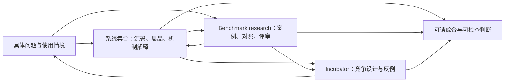

# Relata 的愿景、能力版图与连续建设

**状态：** 研究与开发方向的编辑综合，依据现行 Charter、accepted decisions、已实现的公开源码和研究产物；不是新的 execution envelope、评测协议、accepted Tilia 架构或结果发布许可。精确证据状态由 [STATUS](../STATUS.zh-CN.md) 维护。

## 中文摘要

Relata 要成长为能够提出自己的问题、解释真实系统、产生可检查研究与设计认识的前沿记忆研究室。它自己的 benchmark research、system collection 与 incubator 互相支持，各有独立成果。成熟度来自一个问题能否沿来源、机制、实际观察和竞争解释转成有用认识，而不只来自工具数量或平台规模。当前建设把已有十系统研究接成五个问题导向的静态展品及离线 reader，也为具名 RC-005 补上可恢复的首次盲评、追加导入与分歧报告；研究与工程状态仍需分开，语义评审、有效案例、长期使用与更广系统比较仍是未完成工作。

## English summary

Relata aims to become a memory research lab with its own questions, inspectable system studies and evidence-grounded design insight. Its benchmark research, system collection and incubator retain independent value. The collection connects ten pinned source models into five question-led static exhibits with an offline reader and a generated GitHub-readable edition. The fixed RC-005 study also has a resumable offline first-pass review desk with source-bound imports and descriptive disagreement reports. Source synthesis, tooling, runtime observation, semantic review and accepted comparative claims remain distinct. The collection does not execute systems, publish private runs or select Tilia's architecture.

## 为什么存在，哪些选择已经改变

原始 [Draft 0.1](../docs/vision/relata-target-architecture-draft-0.1.md) 最有延续力的问题，是系统怎样保存和延续共同历史，并忠于来源、时间、变化与当前语境；它明确指出“检索成功”之后仍可能使用失败，也希望 builders 能沿可检查路径找到修复位置。具体的四 tracks、reference world、平台服务和评分栈是当时选定的方案，不能与这个问题本身混为一谈。

随后的决定不是简单地往原平台补功能。[ADR-0001](../decisions/ADR-0001-research-first-bootstrap.zh-CN.md) 将有效构念与案例放在平台之前；[ADR-0003](../decisions/ADR-0003-mixed-domain-memory-ecology.zh-CN.md) 保住普通生活、共同工作及混合领域；[ADR-0006](../decisions/ADR-0006-frontier-memory-research-lab.md) 让一般 agent memory、概念研究、源码比较与文章取得独立地位；[ADR-0008](../decisions/ADR-0008-three-core-research-functions.zh-CN.md) 接受三项核心职责。亲密关系仍是 founding focus，无需把所有研究变成关系案例，也不应把关系中的普通事情强行赋予浪漫象征。

[ADR-0007 的更正](../decisions/ADR-0007-local-memory-apparatus.md) 则明确了长期目标和实现权限的区别。研究可以为独立 Tilia 提供理解与竞争设计，不能因为某种表示较容易编写、审计或测试，就把它提升为完整产品的目标。向量语义检索是未来 Tilia 的既定要求；事实内核、context 编排、自组织、学习、持续背景等具体组合仍有研究空间。

这些变化保留了原始意图，也扩大了它的实际价值：Relata 能帮助人理解 memory 的不同实现，发展自己的评价方法，并将新认识转为设计选择。它不需要先变成通用 runner 或托管平台，才有资格交付这样的成果。

## 成熟时，使用者应当能做什么

研究者从一个具体问题进入，能找出 materially different 的机制，知道保存、选择、交付与使用各由谁承担，看到证据、条件、竞争解释和未覆盖部分。Builder 能用同一条路径判断值得采用什么、哪个集成层仍缺责任、一次失败还需要什么观察；源码存在与实际有效不会被混成一个能力标签。

Case author 和 reviewer 能判断一个任务为何需要历史、允许哪些行为、哪些澄清合法，以及哪些差异来自材料、架构、reader 或评审本身。贡献者能带来自己的概念、事件和反例，不交出 raw private chat，也不被当成预定 rubric 的供料者。Incubator 能提出超出事实检索的理解、关注与学习机制，同时允许强原文方案推翻复杂设计。

这是一组真实使用能力。是否需要服务、统一界面或更广执行层，应由这些使用路径的实际需要来决定；已有命令数量、测试数和精确记录本身不足以证明研究室成熟。

## 现在真实具备什么

| 工作面 | 已经可用的能力 | 证据到达哪里 | 还缺什么 |
|---|---|---|---|
| 概念与研究 | 开放 research questions、竞争解释、来源方法和多份有界研究 | 形成了可读论证、有限输入性质与具体研究问题 | 定稿综合、反证、更多方法和使用情境；不能由文档数量推断认知增量 |
| 系统集合 | 十份 pinned source studies、三十视图、三张 source-reviewed Cards、pressure map；新增五问题展品与同源 Markdown | 可离线从问题进入比较，追到模型节点及固定源码 | 独立人类 review、样本覆盖补充、获准且经选择的运行展品；当前没有公开比较成绩 |
| Case Lab | RC-001 clinic-ready、其余 seeds、benefit controls、future-question 固定材料 | 输入、投影、有限交集与工程绑定可以重算 | accepted cases、独立语义评审、受控使用结果和 reviewer calibration |
| 执行与评审工具 | RC-002 scripted 演练、fixed-study export/import/recompute、RC-005 named CLI／首次盲评台／累计导入与分歧报告、P0 离线审计准备 | 各工具有明确入口与离线检查；native 与 P0 权限限于具名包 | 语义结论须依实际观察和评审；公共工具不能据私人运行记录自行产生公开结果 |
| Incubator | 竞争设计、机制/测试映射、修订、检索与学习问题 | 可提出具体取舍与可反驳假设；早期独立实验有自己的有限工程证据 | 独立 Tilia 的完整体验、架构选择与实现；当前研究不承担该产品身份 |
| 社区参与 | contribution、consent、attribution、withdrawal 与 clinic 材料 | public-safe 的参与方式已描述 | 尚未实际走通的贡献与评审路径；敏感收集前的 restricted stewardship 决定仍开放 |

这里的阶段仍是 **R0 Research Foundation，已具备可执行的具名研究工具与可用的静态 collection**。工程链的可运行性、真实调用是否发生、输出语义质量和 accepted result 是不同事实。没有出现在公开研究中的私有结果，既不能公开升格，也不能反向写成“从未执行”。

后续开发把具名 RC-005 的匿名回答交接接到了[离线语义评审台](../case-lab/reviews/workbench/README.md)：读历史和原样回答、保留未完成草稿、明确修订旧判断、累计交回、原运行核验与分歧报告已形成一条工具路径。公开七项练习只检查操作与互通；它不生成独立人类评审或语义效果证据。原包与恢复状态、browser 提交与正式导入、技术失败与空回答保持各自含义。下一步可以使用这条路径推进有依据的 review，而不再为同一 handoff 补平行工具。

## 方向风险与值得继续发展的优势

**最值得保留的优势是因果路径与对象边界意识。** 完整历史、可搜索原文、事实层、图、文件式上下文、派生理解和 prompt 改写可以共同成为研究对象；Relata 已经能指出它们在什么地方交付不同的东西。固定源码、显式竞争解释和强原文对照让判断可被检查，混合领域和关系局部规范又使它不必退化成单题检索正确率。

**目前最具体的能力缺口是材料之间的使用连接。** 项目索引适合熟悉名字的人，却让带着问题的读者自己拼接十份报告、三十幅图和案例。新增 [五问题 reader](../systems/architecture-atlas/index.html#questions) 与 [GitHub 可读版](../systems/architecture-atlas/exhibits.md) 直接处理这条缺口：情境 → 当前任务条件 → 跨系统机制 → 源码和节点 → 对照与研究去向。它形成了 collection 的独立可用成果。

**需要纠正的惯性是让最易形式化的题目占据全部 programme。** 更正、权限、hash、receipt 和状态一致性各有用途，却无法替代 memory 带来的帮助、概括与理解、经验迁移、持续关注、自然共同生活和用户解释负担。候选 B 因已有组件表而更像默认答案，是研究材料的呈现优势，不是比较优势。本轮将它明确收回到有界设计研究的位置，自组织与学习不再由其完成度决定何时可以研究。

**评价材料仍需要独立于作者自己的设计。** 已知 synthetic family 的多个变体、重复或 checkpoint 不能填补独立性；保存完整原文也不能保证 reader 用对；离线 schema 和绑定检查不能校准语义判断。应保留真实的缺项，而不以增加 metadata 或缩小任务口径使报告更好看。

## 连续建设怎样推进

下面是完整 programme 的持续结构；它补充 [first research cycle](first-research-cycle.md)，不把五个展品变成永久 tracks，也不扩大具名 study 的权限。

箭头表示研究材料和问题的流动，不是已部署服务或统一执行接口。各研究职能都可以独立交付；实际运行另依其接受的 envelope，公开运行展品还需结果披露权限。

1. **让 collection 形成可读且可取用的认识。** 本轮已实现五问题静态展品，覆盖未来用途、交付终点、更正、适时出现和经验适应。继续时优先深化具体论证、补充能改变判断的简单对照和异质样本，再加入获准披露的运行证据。每次更新同时维护来源、判断与未知，不用新项目数量替代解释深度。
2. **让自己的 benchmark 研究产生可信判断。** 从既有 case 与具名运行的真实问题选择下一批语义 review，保留 support、合法行动、澄清、guessability、technical failure 和分歧；必要性、实际收益、scope/silence 与长期负担分别研究。增加真正不同的 family、较长历史和独立未来问题作者，按对应权限执行，不能用全局总分提前遮住边界。
3. **让孵化围绕记忆的用途生长。** 用同样 raw 材料比较概括、来源重访、持续背景、组织变化、prompt 适应和学习的作用；在具名授权下作机制观察。要求每次复杂化能说明实际帮助与维护代价，同时保留向量语义检索和独立 Tilia 的完整目标。Relata 的 evaluator 不接受任何候选内部表示作为标准答案。
4. **让社区与综合真正反馈进研究。** 先围绕 public-safe 材料和明确问题练习 review，未来获得相应授权后再进行外部贡献或正式研究。文章按已经成熟的认识独立成型，不等三职能全部完成，也不强迫原有长篇写作服从最近实验的主题。

下一阶段的主要增量应是**新的研究认识和使用证据**。当前工具已经足以支持许多有界工作；只有明确阻塞这条路径的工具缺口才继续补。Prospective continuity、companion migration、经验迁移、长期共同演化和社区路径都保持去向，不由本轮静态 reader 冒称完成。

## 本轮调查与证据范围

本轮阅读完整 2,484 行原始 vision，核对现行 Status、Charter、Assumption Register、accepted decisions 及关键 Git 变更；追溯研究入口、首轮 programme、候选设计和十模型中的原生对象、节点与来源。工具责任审查覆盖 public tools、RC-005 entrypoints、tests 与 CI，并执行离线检查与公开 synthetic CLI 演练。十个 upstream 的全部源码没有在本轮重新逐行审计，391 个外部 source anchors 也没有逐条重新联网验证；展品复用的是已声明覆盖的 pinned source studies，不把复用描述成新的上游实测。

外部定点核查包括 [LongMemEval v2](https://arxiv.org/html/2410.10813v2) 的摘要与 indexing/retrieval/reading 方法段，以及 [Letta Context Repositories 官方说明](https://www.letta.com/blog/context-repositories/) 的文件、渐进读取与反思机制。前者提醒系统环节与最终任务需分开观察，后者提供原文/工作上下文组织的一种实现方向；两者均不代替当前 pinned source，也没有在本轮复现性能。这些来源不能支持“Relata 的问题此前无人研究”或“Git 版本即语义可靠”等更强结论。

私有运行材料、真实聊天、provider 配置与账号未进入新 collection；本轮没有新增 study dispatch、独立人类 review、Tilia 产品实现或 hosting。Reader 的 rendered QA 与离线 checks 证明对应交互和生成关系，不证明展品中的未来行为假设。
