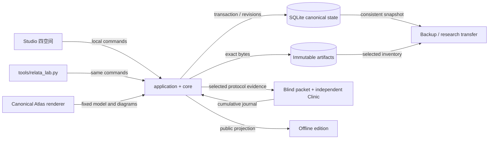

# Relata Next Generation：本地研究室与继续研究的方向

**状态：** [ADR-0011](../decisions/ADR-0011-local-research-studio.zh-CN.md)接受本地实现范围；当前交付是 source implementation、离线工具和有限作者环境。没有新 provider 运行、人类招募、正式 release 或 hosted service。用户操作入口是 [Studio](../docs/studio.md)，长期身份仍是自己的 benchmark research、系统 collection、独立未来系统的 incubator。

## 一份研究怎样留下来

下图描述实际源码的状态所有权与交接，不是受测系统架构。`core.py` 是唯一状态写入口；HTTP 与 CLI 调用同一 application。浏览器不会得到原 native runtime config；独立 reviewer 使用单独导出的材料。

Atlas mount instances 各自拥有 navigation、DOM、事件和 source resolver。十个现有模型、三十图和五个展品保留原源头，不另建 topology。workspace 保存确切 payload；source text 只有明确提供后才随包保存。原上游 URL 不伪装成离线源码副本。

## 本轮完整路径与实现选择

| 需要完成的研究行为 | 当前入口与责任 | 证据边界 |
| --- | --- | --- |
| 草稿、问题、竞争解释与数周后的回访 | Desk；`working.save` 与 immutable object revisions | draft 不等于已冻结 evidence；冲突需要明确处理 |
| 两个系统／版本并排、固定比较与回到节点 | Observatory；canonical Atlas mount + CAS snapshot | 静态 source-inspected，不是 runtime trace；split／merge／unknown 为 analyst mapping |
| 共享轨迹、所有 planned positions、重试与 raw observation | Study；run、attempt、observation | manual dispatch 是外部声明；uncertain 不自动重发；native 执行仍具名 |
| 读旧研究，当前材料改变后仍能检查 | read-only compatibility registration；原 verifier 首次核验后冻结 | 缺少原依赖不能重造 native binding；历史 reader 不重写旧格式 |
| 两种首评、诊断、新 rubric、同人修订与多人分歧 | 新 Clinic + frozen rounds；原 RC-005 Workbench 保留 | development contracts；无独立 reviewer 时无 calibration claim |
| 可以推翻简单命题的三组仪器 | allowlisted measurement／applicability／opportunity | 作者合成环境和算法结果；19 条相关轨迹、122 个事件不是独立模型试验 |
| 从观察和评审形成自己的解释 | Analysis workbench；精确材料引用、竞争解释、不可变修订与评审变化提示 | 私人作者分析；不自动判真、打分或接受；主张另写可披露正文 |
| 主张、反例、来源修订、选定公开作品与恢复 | Library、public projection、四种 export profiles | 公开作品仅披露已选版本，不能验证 withheld dependencies |

实现采用 Python stdlib、SQLite 与 plain ES modules，复用已有 Node renderer。提案中的 TypeScript monorepo、更多目录层级、通用 driver registry 没有成为当前必要条件；已有模块边界可以提供完整本地行为。原 RC-005 精确绑定和新探索性 partial study 保持不同入口。当前没有自动 schema migration 或实时多人协作，也没有新增 provider adapter；任何未来执行仍需要具名 envelope。

[来源比较文章](collection-delivery-comparison.md)把检索、交付、消费与更正的不同责任写成可反驳论点。[有限仪器报告](finite-instrument-report.md)说明真实离线结果：强 current-only 已能完成适用性任务，表面规则与全面停用均会失败；task ledger 能在作者事件环境中避免重复／撤回／撤权后的误行动。这些结果限定于确切材料和规则。Library 的“载入两篇研究作品”会将正文固定为可修订的对象。

## 六条研究线各自继续

| Programme | 现有材料与本轮增量 | 下一项需要的认识或证据 |
| --- | --- | --- |
| P-A 仪器可见性与测量敏感性 | field census、三投影、global-intersection、empty 与 response act；新 mapping 保留 unmapped | 判读差异是否来自信息丢失、合同不足或合理分歧，需要固定响应的具名研究；变化本身不等于仪器失效 |
| P-B 未知未来用途与可恢复性 | [future-question](future-question-memory/README.md)；source re-access、澄清、虚拟期限与读取预算 | 独立未来问题作者与真正的 system reader；不把现有作者 families 称为 held-out |
| P-C 方法适用性与可逆适应 | [experience adaptation](experience-adaptation-study.md)；surface × purpose、formation／consumption、局部干预和邻居 | 当前 formation 只读示例字段；自主形成方法和语义迁移尚无运行证据 |
| P-D 持续意图、机会与退休 | opportunity timeline、task ledger、完成／撤回／撤权与 attention budget | 长期事件和原生 scheduling seam；当前虚拟环境不证明实际提醒收益 |
| P-E 共同工作中的资料生成与记忆反馈 | transparent reactive world；纠错可增加被纠错项频次的存在性反例 | 真实共同工作、用户解释负担和主观感受需要单独的人类研究边界 |
| P-F 更正后的影响、并发与维护生态 | [correction propagation](correction-propagation-study.md)、[race challenge](correction-race-challenge.md)、[Hindsight audit](stale-write-source-audit.md) | 具名 native seam 的观察、代价与未受影响邻居；静态阅读不能宣称 race 已复现 |

这六条线组织问题，不形成永久 tracks、统一 ontology 或通用评分。跨语种／媒体、companion migration、长期亲密关系、社区贡献和未来 Tilia 都保留在[完整能力版图](lab-development.md)与已有研究里。本轮本地工具使这些研究可接续，不替代它们的材料作者、运行权限或接受程序。

## 验证与使用边界

`tests/test_lab_core.py` 检查 immutable revisions、head conflicts、attempt chain、两协议、精确引文、修订、盲包、恢复、transfer 与 public projection；`tests/test_lab_application.py` 实际运行三个仪器、跨关闭重开、空库恢复、固定 snapshot 与真实 loopback 请求。Atlas／Studio browser checks 使用 bundled Chromium，验证双实例、真实评审交接与响应式界面。完整命令见[维护验证](../docs/studio.md#维护验证)。测试通过只对应其工程条件，不代表 owner 使用接受或科学校准。

原始 native records、review mappings、运行配置与私人 research-transfer 始终留在本地。公开仓库只包含源码、公开 synthetic 材料和经过边界说明的作品。后续若改变 provider activation、参与者、数据范围或公开 hosting，重新做对应决定，不从本地工具的存在推导权限。
