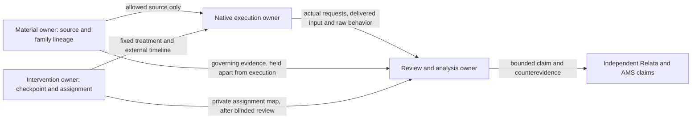

# Relata × AMS: evidence, action and continuity

**Status:** adopted research direction and bounded preparation, 2026-10-23. P0 has a separately named [reader-only follow-up](../experiments/rc005-exposure-followup.md); P1–P6 are research designs, not completed experiments. This document owns the cross-project questions and dependencies. Each repository retains its own experiment implementation, evidence and claim authority.

## 中文摘要

本轮把“保存、检索、实际暴露、可解释、行动、收益”分开。先解释 RC-005 的原生字段在 reader 交接时丢了什么，再研究未知未来用途与更正传播；目标承接、记忆时机、关系修复和测量反应性保留各自可反驳的设计。共享材料不增加独立样本数，shared receipts 不成为统一 runner 或 memory ontology。AMS 的参数学习和 KV/cache 研究继续独立；Relata 的人与互动研究也不能由检索或 scripted gold 代替。

## English summary

This campaign separates retention, retrieval, actual exposure, interpretability, action and benefit. It starts with an audit and paired reader intervention over existing RC-005 captures, then develops future-use and correction research. Goal-conditioned action, timing, relational repair and measurement reactivity keep separate estimands. Shared materials and evidence do not create independent replications, a shared runner or a universal memory schema.

## 1. Responsibility and evidence

| Question | AMS responsibility | Relata responsibility |
| --- | --- | --- |
| What carries past experience forward? | Explicit records, representations, learned parameters, cache, retrieval and use policies | Source-grounded system studies, native exposure, architecture pressure and case boundaries |
| What changes subsequent action? | Task-relative information and intervention effects, costs and competing mechanisms | History-dependent legitimate action, repair, appropriate use/silence, user control and burden |
| What remains independent? | Parameter learning, cache intervention and cross-model transfer need no prior relational application | People's experience and local norms need independent interaction and human evidence |

Both projects conduct theory, source investigation and experiments. Relata retains its [three functions](../CHARTER.md); AMS retains its [inheritance thesis](https://github.com/IndelibleVivi/agent-memory-study/blob/196880924ae501dd8103bdcb4c03e5c27c7df8ed/study/programme/thesis.md). Tilia's product needs do not determine the answer.

The review snapshot was Relata `e39a8af`, AMS main `1968809`, [PR #7](https://github.com/IndelibleVivi/agent-memory-study/pull/7) at `759f7151` and [PR #8](https://github.com/IndelibleVivi/agent-memory-study/pull/8) at `383ac14e`. These are versioned observations, not floating claims about main or deployment. PR #8 already supplies content-bound reviews, representation receipts and a revision apparatus. Its structured/scripted results are not natural-language model results. AMS also has real FTS5 retrieval, trained logistic parameters, real-model cache interventions and a Qwen native K/V round trip; none is erased by the scripted nature of another study. Cross-model mapping, semantic generalization and agent benefit remain separate questions.

Reuse the seven [future-question families](future-question-memory/README.md), five [benefit families](continuity-benefit-study.md), RC-005, and AMS development families as development material. Preserve family lineage across projects, worlds, translations, paraphrases, repeats and checkpoints. Two analyses of one family are not two validations. New independent authorship and held-out status must be evidenced rather than inferred from another worker or repository.

## 2. Concepts and counterexamples

The observable chain is retained state → retrievable material → delivered input → supported interpretation → legitimate action → causal benefit. Evidence for one link does not establish the next. `used` may remain unknown even when a citation is valid.

For history `h`, representation `T(h)`, question `q`, and allowed terminal actions `A(h,q)`, a single-step representation-only decision rule can exist only when every identical-view class has a nonempty **global** intersection of allowed actions. Pairwise intersections are insufficient. This finite existence result is not a claim about a bounded reader's computation. Clarification, retrieval and file access change the object into an interactive strategy with costs. Preserve AMS PR #7's lossy-but-sufficient positive control alongside Relata's collision examples.

Future-question research studies later uses not supplied to the writer. Prospective memory usually concerns later execution of an already formed intention; it is a mechanism reference, not an equivalent construct. A correction is not simply the latest message: authority, scope, valid time, observed time, commit time and exposure time can differ. A goal can persist while its plan fails; a plan can remain executable after the goal changes. Familiar language and relational continuity are independently testable.

| Hypothesis | Strong competing explanation | Discriminating control |
| --- | --- | --- |
| Compression loses needed information | Long raw context overwhelms the reader; a summary helps | Full and equal exposure; raw+summary; actual sufficient subset; source re-access |
| Restored source fields help | Length, repetition or formatting changes; attribution is wrong | Fixed capture, format control, later length control and field ablations |
| Correction failed to propagate | Message lacked authority; scope differs; historical answer is still valid | Authority/scope/time negatives and historical probes |
| A citation proves memory use | Post-hoc explanation or redundant information | Paired removal/replacement and complementary-group intervention |
| A stronger model does not need memory | Task already supplies the information or exposure is mistimed | Information novelty × capability × timing, plus no-history-needed tasks |
| Familiar expression improves continuity | Ratings improve while agreements are still violated | Repair × expression, downstream action and calibrated trust separately |
| Dependency graphs beat versions | Graph arm has extra recomputation or oracle knowledge | Equal operation capabilities; automatic dependency, re-read and oracle separated |

## 3. Seven independent packages

### P0 — native exposure and provenance

Object: the fixed Mem0 configuration → Relata projection → common reader chain, not an intrinsic Mem0 agent. Audit bound captures for missing, null, empty, nonempty-but-dropped and already-exposed fields. Preserve types, order and missing/null. Treat timestamps as processing times until independently justified; native attribution remains extractor output, not source truth. Textual entailment or conflict with history requires semantic review.

Fix capture, query, candidate order and reader. Compare the historical projection, complete nested native entries and a format-only rearrangement of historical fields. The [offline audit](../experiments/rc005-exposure-audit.md) prepares these inputs; the [finite follow-up packet](../experiments/rc005-exposure-followup.md) specifies actual dispatch separately. Keep original runs unchanged. If the whole-field contrast merits expansion, use attribution × other added fields and a length-matched unrelated control. Human-corrected attribution belongs only in a separately marked extra-information oracle.

Primary outcomes for calibrated review: supported source attribution and legitimate current arrangement. Diagnostics: unsupported certainty, specific clarification, tokens, latency, native attribution conflicts and truncation. A field absent from the native return rules out this particular projection-loss path at that position. A narrow interval near a predeclared negligible effect can weaken the behavioral hypothesis; an imprecise nonsignificant result cannot. One family supports local mechanism evidence only.

### P1 — future tasks, retention and re-access

Separate average performance over a declared future-task distribution from exploratory counterexamples. Freeze the retention policy before a second author, who has not seen its deletion rules, writes future tasks. Approximately 24 new families is a pilot material target, not a power calculation. Existing public families remain development controls. Record access history and author overlap; a function lacking a `question` argument does not establish author blinding.

Use history fixed/updated × tasks current/expanded. Pair unchanged anchor questions; report added tasks separately. Include ordinary, project, shared-agreement and no-history-needed cases. Compare no history, complete permitted raw source, literal BM25, dense+session retrieval, automatic summary, and summary plus iterative re-access. Candidate pools must exceed top-k and include similar records from other scopes. Re-access distinguishes current, missing, denied, known-stale and unknown-stale sources.

Primary outcomes: task completion and unsupported definite answers. Record candidate/selected/delivered support, actual-input sufficiency, clarification and total cost. Equal reader exposure and equal pipeline cost are distinct analyses. Simple source search matching the complex method, or a summary beating raw context under a bounded reader, is a useful result.

The PMMC-inspired subpackage first tests re-executable retrieval programs after source updates and permission changes. Compile-time auxiliary answers must not enter runtime evidence. Program correctness, source access and answer isolation precede benefit claims; no runnable PMMC reproduction is claimed here.

### P2 — correction, derived influence and reappearance

Map actual storage, index, summary, delivery, action and subsequent writeback. Cover retrospective factual correction, revoked commitments, scope narrowing, expired exceptions, changed premises and authority conflict. Negative controls include a newer message without override authority, another project's change and a historical question whose old answer remains valid.

Before implementation, name observable state, copy/fork semantics, native API effects, asynchronous work and unknown layers. Branch from the same pre-correction checkpoint where support exists; otherwise describe a weaker sequential design. Compare native update, source re-read, version-without-recompute, automatic dependencies and a correct-dependency oracle; cross with writeback allowed/blocked. An API that changes several layers estimates an operation effect, not independent layer effects.

Measure changed/preserved/boundary at tasks 1, 3 and 10 and fixed recovery points. Boundary is part of preserved. Distinguish persistent error, a repaired old influence reappearing, and a new error. Reappearance needs stable query identity and expected-answer phase. Natural stale retrieval and forced old-output retrieval are separate conditions. Keep each branch's actual subsequent writeback history rather than matching it away.

Primary outcomes: first correction and old-influence reappearance. Diagnostics: support versions, refresh delay, false invalidation, repair cost and unchanged neighbors. Native safeguards being sufficient, re-reading being cheaper, or benefits existing only with an oracle graph can defeat the proposed mechanism. Hindsight's single/batch and manual/auto freshness paths require the same pinned source and refresh phase before comparison.

### P3 — action under historical goals

Operationalize goal understanding as observable action under historical constraints. Hold the current request and tool state fixed; vary accepted goal unchanged/changed × old means valid/invalid. Add unaccepted proposals, explicit rejection and quoted third-party plans; balance acceptance, source position, recency and length. Ordinary inputs contain readable evidence, not gold goal labels, `accepted=true` or answer-bearing filenames.

Compare raw retrieval, plan-centered summary, faithful source quotations and automatically inferred intent indexing. Test wrong-but-nonempty labels as well as no-match labels. Source/oracle intent labels are an extra-information bound. Include tasks requiring no history, legitimate ambiguity and current full-evidence controls.

Primary outcomes: completed action and constraint violations. Distinguish sufficient delivery, evidence obtainable but not obtained, and legality against full governing history. Goal-restatement probes use a separate fork. Correct restatement with wrong action, evidence blocked by intent labels, or more questions with less task completion are counterexamples. No internal understanding-state claim follows.

### P4 — benefit and timing

P4a estimates a local exposure effect at checkpoints reached by an untreated reference policy. Mark difficult and ordinary states before treatment; randomize correct memory, length-matched irrelevant material and no memory at the same checkpoint, comparing one-shot with continued exposure.

P4b assigns early, fixed-late, difficulty-triggered or never-inject policies **at task start**. All assigned trajectories enter the denominator, including those where no trigger fires. Selecting only difficult trajectories after running the policies conditions on a possible treatment consequence and does not estimate the same effect.

Precheck correctness; separate new, redundant and out-of-scope material. Hold writer/retriever fixed before capability interactions. Intervene on complementary memory groups as well as individual items. Gold-aware CMI-style utility is an offline diagnostic; an online controller may use only then-available signals. Primary outcomes are task success and total resource cost. Strong no-memory controls, late triggers, expensive repair or continued influence through paraphrases can overturn a benefit claim.

### P5 — continuity, repair and people's experience

Relata owns a separate interaction design. A 12–16-person formative study would expose material/rubric disagreements; it is not a confirmatory sample-size justification. Vignette replay measures perceived continuity in someone else's history. Claims about one's own shared agreement require participants to form an agreement first; long-term claims require longitudinal evidence. Recruitment, consent and any applicable institutional review precede collection; this campaign has not started them.

Cross correct/incorrect repair × familiar expression present/absent, matching length, tone and task information. Include accepted/mentioned/rejected agreements, private/public audience and local exceptions. Retain three evidence states: clear agreement, no agreement, and genuinely missing context. They distinguish repetitive questioning from necessary clarification.

If repair correctness is authored into the stimulus, measure its effect on subsequent completion, repair rounds or repeat-explanation time; the manipulated correctness is not a discovered system capability. Native repair reliability requires separate system research. Report control, abandonment, subjective continuity and trust calibration; prediction probabilities/Brier score measure predictability, not relationship quality. Emotional burden needs people's reports and interviews. Familiarity improving ratings without repair, or correct action not improving perceived continuity, are valid separations. Preserve normative disagreement, carryover and expectation effects; model judges do not replace people.

### P6 — measurement reactivity

From a common checkpoint compare no probe, retrieval probe, reflection, natural continuation and length-matched sham × writeback allowed/blocked. Declare what blocking actually covers: active context, persistent text, derived indexes, access counters, cache and background work. Unfreezable layers stay unknown. User source, assistant output and inference retain distinct identities; probes get no gold.

A new reader faces fixed later tasks. Primary outcomes: unsupported-conclusion persistence and task correctness; trace writes and retrievals. Effects confined to active context support that narrower object. Near-zero effects need predeclared equivalence bounds, precision and observation windows. A successful probe establishes recoverability at that time, not prior task use.

## 4. A thin evidence interface

The proposed flow below describes responsibility, not an implemented shared service. Existing AMS receipts and Relata source-bound export remain in their owning experiments. Two complete studies must demonstrate a real common consumer before extracting a common component.

Each study keeps nine kinds of evidence, using existing formats where possible: (1) manifest with estimand, versions, independent unit, 1–2 primary endpoints and stopping rules; (2) source/family lineage; (3) native snapshots or declared unavailable state; (4) actual request/response receipts, attempts, identity, usage and opaque retries; (5) candidate/selected/delivered material; (6) forks, intervention and writeback timeline; (7) raw behavior; (8) reviews/disagreement; (9) a bounded claim with strongest competing explanation. Missing records are explicit, not invented placeholders. The [Evidence Card](evidence-card-template.md) remains the claim container.

Review uses the [calibration worksheet](../case-lab/reviews/continuity-review-calibration.md): expressed content, evidence support, action legitimacy and clarification are separate judgments. Receipt identity, run completeness, semantic validity, causal identification and generalization are five different conclusions. Condition guessability remains visible even in anonymous packets.

## 5. Analysis, cost and stopping

Families and participants are independent units; repeated calls, languages and checkpoints are correlated. Use family-paired analysis and appropriate participant/case clustering. Report all-assigned completion, semantic quality among completed answers, and consumption quality among sufficiently delivered inputs with separate denominators. Empty content, technical failure, pending, not-run and unreviewed are distinct. Report missingness and reasonable bounds.

Report all inputs and the prespecified common-sufficient subset together. Do not define that subset after looking at answers. Bytes are not tokens; configured caps are not actual usage. Expand lifecycle cost as `C_build + n*C_query + u*C_repair`, retaining tokens, calls, walltime, cache and human work separately. No exchange rate converts relationship burden into tokens. Oracle arms do not enter fair winner rankings.

Stop adding mechanisms when a strong simple baseline explains the result. If native layers cannot be observed or separated, narrow to operation-level or black-box effects. Preserve null effects, wrong-field amplification, summary advantages and failed safeguards. Exact receipt checks establish identity; recomputation over frozen responses establishes analysis replay; reissuing a provider call does not promise identical output.

## 6. Sequence and evidence destinations

| Package | Current delivery / next discriminating evidence | Owner / destination |
| --- | --- | --- |
| P0 | Bound offline audit and three projections; separately bounded paired reader follow-up; semantic calibration remains pending | Relata [experiments](../experiments/README.md); raw records local/private |
| P1 | Independent future-question handoff and baseline protocol; frozen development controls retained | AMS [cross-project package](https://github.com/IndelibleVivi/agent-memory-study/tree/research/executable-memory-experiments/research/relata-ams-campaign); Relata future-question study |
| P2 | Native operation/observability map before new subject execution | Same AMS package; Relata [correction study](correction-propagation-study.md) |
| P3 / P4 | Explicit goal/means controls and separate local/policy estimands | This design; future named material/execution packets |
| P5 | Formative material and norm calibration design, no participants collected | Relata calibration worksheet and independent human-study protocol |
| P6 | Read/write and hidden-state boundary design | This design; future named checkpoint study |

Three potential paper evidence chains remain independent: future-use sufficiency/recovery; correction/derived influence/reappearance; continuity/repair/experience. AMS's computational source-influence and experience-to-use-policy lines remain independent technical branches. P3/P4 can stand alone or inform another line if actual evidence warrants it. Negative results belong beside positive ones.

## 7. Mechanism leads and incorporation decisions

The supplied second review and expanded HTML are one review, not two sources. Its P0 loss claim is checked against the pinned local Mem0 source and actual private records; numerical runtime evidence is not published here. The existing [first cycle](first-research-cycle.md) remains useful for its cases and narrower questions; this campaign adds cross-project questions rather than discarding those controls. Existing export/receipt/binding capabilities are reused, not rebuilt as missing features. No platform, canonical ontology, model judge or Tilia architecture is adopted.

The versioned primary-paper pages were reopened for this incorporation; this is page-identity and selected method/evaluation coverage, not a full close-read of every paper. The supplied review provides the broader source interpretation. The descriptions below are mechanism leads, not independent reproductions or accepted Evidence Cards:

| Source / reading scope | Question carried forward | Limitation / destination |
| --- | --- | --- |
| [STITCH v2](https://arxiv.org/html/2601.10702v2), intent-aware method | Can wrong nonempty intent filters hide needed evidence? | P3; label schema does not prove goal understanding |
| [PMMC v1](https://arxiv.org/html/2608.00962v1), compilation and online execution | Can retrieval programs re-evaluate current sources? | P1 technical probe; runnable reproduction not established |
| [CMI v1](https://arxiv.org/html/2605.17641v1), intervention/evaluation method | With/without/perturbed-memory utility | P4; expected-answer supervision does not supply an unknown-answer online controller |
| [MemDerive v1](https://arxiv.org/html/2610.25373v1), targeted/inherited probes | Recoverability versus delivered derivation support | P2/P6; probe correctness is not prior use |
| [REM v1](https://arxiv.org/html/2610.27377v1), recall/timing method | Difficulty triggers versus phase exposure | P4a/P4b; removal can leave downstream paraphrases |
| [RealCompanion v3](https://arxiv.org/html/2610.01780v3), dataset/evaluation scope | History need, evidence and implicit use | P5; finite real-conversation sample, no universal relational norm |
| [Before Bringing It Up v2](https://arxiv.org/html/2610.09470v2), evaluation/limitations | Appropriate use and clarification | P5; output comparison uses model judges, not human preference results |
| [MemDelta v1](https://arxiv.org/html/2606.29914v1), confounds | Writer/encoder/reader changes can reverse comparisons | P0/P1 controls; paper reports not our reproduction |
| [MemoryTax v1](https://arxiv.org/html/2610.29823v1), setup/limits | Strong raw-context and lifecycle-cost controls | P1/P4; finite dialogue/configurations, not a verdict on all memory architectures |
| [Hindsight pinned source](https://github.com/vectorize-io/hindsight/tree/35451e5fa5b828d90593561bc9fb2d5deb242a32), review-supplied lead | Single/batch freshness and withdrawal checks differ | P2 source map; no new runtime reproduction |
| [RECALLbot official abstract](https://dl.acm.org/doi/10.1145/3772318.3790714), review-supplied lead | Memory with reciprocal disclosure | P5; full text not reviewed here; combined treatment cannot isolate memory |
| [Prospective memory experiment](https://pubmed.ncbi.nlm.nih.gov/16131267/) and [focal/nonfocal study](https://pmc.ncbi.nlm.nih.gov/articles/PMC2864946/), review-supplied concepts | Intention cues versus unknown later questions | Theory reference; not direct agent-system evidence |

New provider subjects/families, human recruitment, private-corpus processing, cross-model training, general infrastructure, result publication and deployment do not follow from adopting this campaign. The named P0 follow-up uses existing synthetic captures and entitlement; its exact limits and actual state have their own packet and private evidence.
