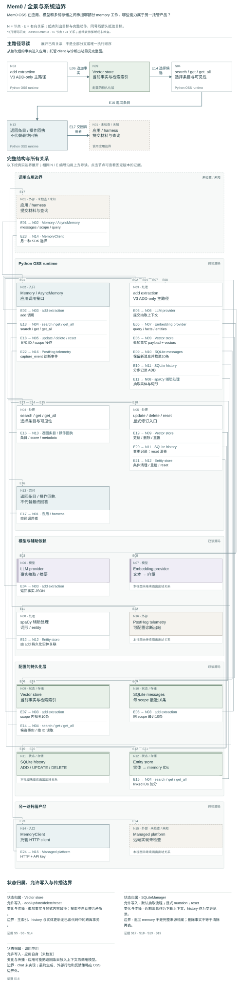

# Mem0 OSS 有界架构研究

**Status:** source-study draft; independent human review pending. These notes are not accepted System Cards or system performance results.

[比较入口](README.md) · [研究问题](../../research/agent-memory-inquiry.md)

## 中文摘要

Mem0 的 Python OSS 将抽取事实、近期消息、实体索引与变更历史组合为应用可调用的 memory 层。本文沿形成、检索、交接与使用追问它实际承担了什么，并与 Letta、Graphiti 和允许原文基线对照；较短的事实表示可能帮助当前任务，也可能失去未来用途所需的区别。比较保留各对象的版本和证据边界，不产生性能排名。

## English summary

A bounded source study of Mem0 Python OSS as an application-facing memory layer. It examines what extraction, retrieval and delivery preserve, compares responsibility boundaries with Letta, Graphiti and raw-source controls, and keeps task-relative benefits, information loss and actual reader use separate.

首读：2026-09-22；论证深化与 Mem0 关键源码回查：2026-10-24。对象为官方 `mem0ai/mem0` 公开仓库，固定 commit **`a39a802bbc93e85b820078cd3c4dbaf53af25dbe`**。本文的 SOURCE-CLAIMED 指维护方声明或 prompt 规范；SOURCE-OBSERVED 指静态代码可见机制；INFERRED 指由机制推导的条件性解释；UNVERIFIED 指未运行、未测量的效果。本报告的证据范围是静态源码与显式条件推演；独立的 [RC-005 原生研究包](../../experiments/rc005-native-execution-packet.md)和[字段暴露后续包](../../experiments/rc005-exposure-followup.md)分别拥有执行边界。它们的私有原始回答与未评审分析不在本文公开，也不被转换成这里的效果主张。

核心结论：这个版本的 Mem0 Python OSS 把 memory 实现为**由对话抽取、带 scope 与部分来源标签的可检索事实条目，配合最近消息缓冲、变更历史和实体索引**。它是供应用调用的持久化与检索层；记住什么、何时调用、怎样把结果变成可靠行动，仍由模型、harness、应用和人共同承担。当前主路径是 V3 ADD-only，不能沿用旧版自动 ADD/UPDATE/DELETE 的整体叙述。

## 对象边界与证据口径

**SOURCE-CLAIMED：** README 的 LoCoMo 92.5、LongMemEval 94.4 等 headline 数字属于 managed platform，使用 OSS 没有的 proprietary optimizations；“OSS 应有同方向收益”仍是官方预期，本文没有验证。不能把这些数字标作当前 clone 的 OSS 实测，也不能因 evaluation framework 开源就推定平台优化已开源。[README L45–63](https://github.com/mem0ai/mem0/blob/a39a802bbc93e85b820078cd3c4dbaf53af25dbe/README.md#L45-L63)

**SOURCE-OBSERVED：** `Memory` 本地组织 embedder、vector store、LLM、SQLite history；`MemoryClient` 则默认连接 `api.mem0.ai`，要求 API key。相同项目品牌与近似接口，不等于相同执行对象。本文研究前者；也不把 Python library 的结论扩大到 self-hosted server 的认证、TypeScript 或全部 integrations。[本地构造 L487–511](https://github.com/mem0ai/mem0/blob/a39a802bbc93e85b820078cd3c4dbaf53af25dbe/mem0/memory/main.py#L487-L511)、[托管 client L184–228](https://github.com/mem0ai/mem0/blob/a39a802bbc93e85b820078cd3c4dbaf53af25dbe/mem0/client/main.py#L184-L228)

## 生命周期：材料怎样变成可用 memory

**SOURCE-OBSERVED：写入与保留。** `add` 至少需要一个 `user_id/agent_id/run_id`；scope 身份来自显式参数，metadata 不能覆盖身份。默认 `infer=True` 先取该 scope 的最近10条消息，再以整段新消息 embedding 查相关10条 memory，交给 LLM 单次抽取。随后批量 embedding，按文本 hash 在本批与已检索条目内去重，创建 UUID、文本、时间和可选 `attributed_to`，写主索引、history 与实体索引。不是全库语义去重，也不是自动维持唯一“当前事实”。`infer=False` 可逐条保存非 system 消息及 role/name；procedural 分支则生成文本摘要再入库。[scope L360–404](https://github.com/mem0ai/mem0/blob/a39a802bbc93e85b820078cd3c4dbaf53af25dbe/mem0/memory/main.py#L360-L404)、[主路径 L879–1039](https://github.com/mem0ai/mem0/blob/a39a802bbc93e85b820078cd3c4dbaf53af25dbe/mem0/memory/main.py#L879-L1039)、[持久化 L1045–1206](https://github.com/mem0ai/mem0/blob/a39a802bbc93e85b820078cd3c4dbaf53af25dbe/mem0/memory/main.py#L1045-L1206)、[procedural L1993–2035](https://github.com/mem0ai/mem0/blob/a39a802bbc93e85b820078cd3c4dbaf53af25dbe/mem0/memory/main.py#L1993-L2035)

**SOURCE-OBSERVED：检索与交接。** `search` 要求 scope filters，默认 top_k=20；先取 `max(4×top_k,60)` 个 semantic 候选，再计算 BM25 与 entity boost。最终候选只来自 semantic 结果，且 semantic threshold 先于融合分数生效：keyword/entity 命中不能救回池外条目。可选 reranker 和 `explain` 提供可观察调优空间；返回文本、ID、score、时间及 metadata，不生成最终回答，`chat` 尚未实现。INFERRED：这是一种低耦合检索服务边界，同时把 query 构造、上下文预算、冲突处理和行动判断交回调用者。[检索 L1628–1731](https://github.com/mem0ai/mem0/blob/a39a802bbc93e85b820078cd3c4dbaf53af25dbe/mem0/memory/main.py#L1628-L1731)、[分数 L94–139](https://github.com/mem0ai/mem0/blob/a39a802bbc93e85b820078cd3c4dbaf53af25dbe/mem0/utils/scoring.py#L94-L139)、[chat L2168–2169](https://github.com/mem0ai/mem0/blob/a39a802bbc93e85b820078cd3c4dbaf53af25dbe/mem0/memory/main.py#L2168-L2169)

**SOURCE-OBSERVED：更新与删除。** ADD-only 限制的是自动抽取；显式 `update(id)` 仍替换文本与向量、保留创建时间、写 UPDATE 历史，并尝试重新链接实体。`delete(id)` 删除主向量，写含旧文本的 DELETE history，尝试清理实体关联；清理是 best-effort，当前进程未初始化 entity store 时直接跳过。`delete_all` 遍历 scope 的向量条目，所读路径未清理 SQLite 最近消息。INFERRED：操作可审计性较强，但单条删除不能代表来源消除、完全遗忘或下游撤回；残留缓冲可能继续进入之后的抽取上下文，是否再生具体事实需要 probe 验证。[更新/删除 L2038–2126](https://github.com/mem0ai/mem0/blob/a39a802bbc93e85b820078cd3c4dbaf53af25dbe/mem0/memory/main.py#L2038-L2126)、[实体清理 L652–705](https://github.com/mem0ai/mem0/blob/a39a802bbc93e85b820078cd3c4dbaf53af25dbe/mem0/memory/main.py#L652-L705)、[批量删除 L1918–1944](https://github.com/mem0ai/mem0/blob/a39a802bbc93e85b820078cd3c4dbaf53af25dbe/mem0/memory/main.py#L1918-L1944)、[消息保留 L257–324](https://github.com/mem0ai/mem0/blob/a39a802bbc93e85b820078cd3c4dbaf53af25dbe/mem0/memory/storage.py#L257-L324)

## 来源、角色、时间与派生影响

**SOURCE-CLAIMED：** 活跃抽取 prompt 同时接纳 user 与 assistant 内容，要求区分用户事实和助手建议、避免回声重复，并按命名说话者理解多方材料。这让共同工作、计划和 agent 行动进入 memory，不局限于用户偏好。**SOURCE-OBSERVED：** 默认 `parse_messages` 仅保留 system/user/assistant 的 role+content，忽略结构化 name 和 tool role；`attributed_to` 来自 LLM 输出，不能充当来源认证、原文定位或行动已完成的凭据。INFERRED：harness 必须主动保存来源消息 ID、工具执行结果与说话者身份；人仍须决定何种推断允许成为长期条目。[prompt L472–488](https://github.com/mem0ai/mem0/blob/a39a802bbc93e85b820078cd3c4dbaf53af25dbe/mem0/configs/prompts.py#L472-L488)、[归属字段 L924–956](https://github.com/mem0ai/mem0/blob/a39a802bbc93e85b820078cd3c4dbaf53af25dbe/mem0/configs/prompts.py#L924-L956)、[消息解析 L61–76](https://github.com/mem0ai/mem0/blob/a39a802bbc93e85b820078cd3c4dbaf53af25dbe/mem0/memory/utils.py#L61-L76)

**SOURCE-OBSERVED：** prompt 要求 `linked_memory_ids` 表示新旧事实联系，但默认持久化只采纳 text 与 attributed_to；其 UUID mapping 没有进入该持久化逻辑。实际 entity→memory 关联由独立 NLP 阶段建立，不能据 prompt 宣称已有事实之间的修订谱系或依赖撤回。INFERRED：改掉一个错误，不会由这些已读路径自动改掉据此生成的另一条 memory、计划或应用输出。[prompt L506–516](https://github.com/mem0ai/mem0/blob/a39a802bbc93e85b820078cd3c4dbaf53af25dbe/mem0/configs/prompts.py#L506-L516)、[payload L1013–1039](https://github.com/mem0ai/mem0/blob/a39a802bbc93e85b820078cd3c4dbaf53af25dbe/mem0/memory/main.py#L1013-L1039)

**SOURCE-OBSERVED：** OSS 拒绝 `add(timestamp=...)` 与 `search(reference_date=...)`；默认 prompt builder 把 observation date 设为当天，而 add 调用未传入历史时间。虽然可保存 created_at metadata 与文本日期，也支持 expiration_date，但后者只是默认检索/列表可见性过滤，不能等同 temporal reasoning 或物理清除。INFERRED：历史对话回灌必须显式处理事件时间，不能相信“昨天”会自动锚定真实历史日期。[参数拒绝 L817–829](https://github.com/mem0ai/mem0/blob/a39a802bbc93e85b820078cd3c4dbaf53af25dbe/mem0/memory/main.py#L817-L829)、[检索拒绝 L1432–1433](https://github.com/mem0ai/mem0/blob/a39a802bbc93e85b820078cd3c4dbaf53af25dbe/mem0/memory/main.py#L1432-L1433)、[日期默认 L1007–1042](https://github.com/mem0ai/mem0/blob/a39a802bbc93e85b820078cd3c4dbaf53af25dbe/mem0/configs/prompts.py#L1007-L1042)

scope 是调用约定，不是自动识别研究中的内容域或关系边界。按 ID 的 get/update/delete 也没有在该 library 入口接收调用者身份；应用须实施权限和 scope 映射。默认英语 `en_core_web_sm` 支撑 NLP，未装载时可退化；中文效果不能由英文功能表推出。[NLP loader L21–65](https://github.com/mem0ai/mem0/blob/a39a802bbc93e85b820078cd3c4dbaf53af25dbe/mem0/utils/spacy_models.py#L21-L65)

**SOURCE-OBSERVED：** 批量写入失败时，代码逐条重试；某条仍失败只记录日志，后面的 history、entity linking 和返回列表仍遍历原始 records。因此，返回 ADD 事件不能单独证明每条事实已经可检索，history 也不是跨存储事务提交证明。[批量持久化 L1045–1084](https://github.com/mem0ai/mem0/blob/a39a802bbc93e85b820078cd3c4dbaf53af25dbe/mem0/memory/main.py#L1045-L1084)、[返回结果 L1192–1198](https://github.com/mem0ai/mem0/blob/a39a802bbc93e85b820078cd3c4dbaf53af25dbe/mem0/memory/main.py#L1192-L1198) INFERRED：继续处理可保存一部分有用材料，但应用需要独立的落库核验与失败反馈；这项限制不能从正常成功路径的演示中排除。本文未注入故障，不能声称已复现生产丢写。

Relata 可据此把“记忆”拆成可观察的保留、选择、修订和使用环节，而不要仅以是否存在向量库判定。这里保留的是经模型选择的表述，检索分数表达相关性，归属字段表达模型给出的来源分类；它们都不直接等于事实可信度、用户认可或关系意义。对普通项目协作与长期亲密互动，同样需要检查当事人否认、角色错置和过去状态是否仍可恢复；不同应用的重要性权重可以不同。

## 形成记忆时，系统已经作了一次解释

默认 `infer=True` 路径把消息改写成事实表述，然后对这些表述编码、去重和保存；`infer=False` 则逐条保留消息内容，并带 role 与可选 name。两者的区别先发生在“拿什么作为之后可以取回的对象”，不只发生在检索器。若应用需要的是快速得到“当前标题是什么”，一条清楚的事实可能比反复解释数轮商议更容易消费；若后来问“是谁先建议的、何时得到另一方同意”，写入时被消去的协商过程便可能重新重要。这是从两条代码路径得到的条件性解释，尚无本文测得的效用大小。[写入分支 L879–977](https://github.com/mem0ai/mem0/blob/a39a802bbc93e85b820078cd3c4dbaf53af25dbe/mem0/memory/main.py#L879-L977)

由此应区分三个对象：原来发生过的交互、抽取器对交互的表述，以及当前任务可据以行动的证据。它们有联系，却不相互担保。`attributed_to` 是抽取模型给出的分类；条目的 UUID 能定位这一条 memory，不能单独把它还原成某条原消息或证明作者身份。一个条目即使语句流畅、向量相似度高，也可能需要原始语境才能判断它属于提案、接受、转述还是已完成的工作。[消息解析 L61–76](https://github.com/mem0ai/mem0/blob/a39a802bbc93e85b820078cd3c4dbaf53af25dbe/mem0/memory/utils.py#L61-L76)、[抽取后 payload L1013–1039](https://github.com/mem0ai/mem0/blob/a39a802bbc93e85b820078cd3c4dbaf53af25dbe/mem0/memory/main.py#L1013-L1039)

这也解释了为何“加回字段”与“恢复来源”不是同一操作。原生 search 将 `id`、时间、scope 和可选 attribution 等放在返回对象顶层，额外 metadata 另存；调用者若只把正文与 metadata 交给 reader，会形成第二次选择。Relata 的[历史投影函数](../../experiments/rc005_native.py)与[离线字段审计](../../experiments/rc005_exposure.py)把这条交接路径显式化。不过，即使把完整返回对象交出去，也只能保留上游实际返回的材料，不能凭字段名称补回抽取时已失去的协商经过。本文据公开代码说明这个机制，不引用私有运行中的错误数或改进比例。[返回格式 L1689–1729](https://github.com/mem0ai/mem0/blob/a39a802bbc93e85b820078cd3c4dbaf53af25dbe/mem0/memory/main.py#L1689-L1729)

## 一个较短表示何时已经够用

下面是为解释机制写的条件推演，不是新案例家族或系统实测：两名成年人共同做一个声音项目，最初讨论名称与分工，后来正式更名。设某个写入过程只留下“现用名为B；封面由甲绘制，声音由乙编排”，没有保留旧名提出者和接受过程。

| 后来的任务 | 这个设定中保留的区别 | 仍需要什么 |
| --- | --- | --- |
| 给当前首页写标题与分工 | 现用名、当前分工 | 在这项有界任务里，较短表示可以已经充分 |
| 写命名沿革或回答旧名由谁提出 | 没有原名提出者与接受过程 | 查回允许的原始记录，或保留未能确认的部分 |
| 为同类作品提出一份新草案 | 当前约束可参与生成，旧细节未必都相关 | 新建议与“过去已经这样做过”的断言分开 |
| 只看当前请求就能完成的排版调整 | 历史可能没有新增必要信息 | 无记忆控制，检验注入是否增加干扰或成本 |

第一行是有损但可能充分的正控制，第二行显示任务变化可以改变充分性，第三、四行防止把历史展示本身当作效用。[未来问题研究](../../research/future-question-memory/README.md)给出了有限材料上的不可区分反例与来源重访条件；那些形式结果没有证明真实 Mem0 总会删除上述信息，也没有证明有限 reader 一定能消费完整原文。

原文保留完好仍可能难以使用：长对话包含反复提议、未接受版本和无关内容，reader 可能跟错对象；原文加概括也可能因重复、冲突或预算挤占而更差。反过来，概括若正好保留当前任务需要的区别，少量清楚材料可能降低重建负担。因此，判断这个 memory 层的价值，应同时问“删掉了哪些以后可能要用的区别”与“它为当前使用省下了什么工作”。后一个收益需要实际任务和成本证据，不能由条目简短直接推出。

## 检索与注入决定哪些理解能够参与当前任务

该 pin 的 keyword/entity 分数只给 semantic candidate pool 中的对象重排。若某条原文或 memory 从未进入这个池，单纯提高其 keyword 命中不能从当前融合路径把它带回来；若条目已经进入候选，提高保留名额或改变 query 又是另一种干预。把这些都归为“向量检索不好”会混淆候选生成、选择与材料表示。[候选形成 L1628–1687](https://github.com/mem0ai/mem0/blob/a39a802bbc93e85b820078cd3c4dbaf53af25dbe/mem0/memory/main.py#L1628-L1687)

同样，拿到 search 返回对象以后，应用还要决定何时调用、送哪些字段、怎样安排上下文、能否查回来源以及什么时候行动。完整条目、只送正文和应用自行重写摘要，已经是三种不同的实际输入。检索分数能够描述这次排序，不能替应用判定当前权限、来源可信度、原计划是否仍成立或这段历史适不适合主动提及。若一个应用补上了这些能力，观察对象应写成 Mem0＋该应用＋reader 的组合；库的简洁接口与完整 agent 的行为不能共用一个未经说明的效果标签。

## 与 Letta、Graphiti 和原文方案比较什么

以下比较固定为本报告的 Mem0 Python OSS、[Letta Code local `f5c5bbc`](letta.md) 与 [Graphiti OSS library `16cdf70`](graphiti.md)，不含各自托管内部或历史实现。2026-10-24 回查了 Letta 的编译／调用与 Graphiti 的 search／消费示例；表中原文方案是显式比较条件，没有在本报告中运行。它们的原生交付终点不同：

| 对象 | 它替后续使用完成了什么 | 交付之后仍须完成什么 |
| --- | --- | --- |
| Mem0 Python OSS | 把消息变为可检索事实，按 scope 选择并返回条目；显式修订 API 执行指定操作 | 应用选择实际交付字段、上下文预算与 reader；reader 判断来源、适用性并行动 |
| Letta Code local | 保留 transcript；模型可改写 Git MemFS；harness 把已提交 core 编译进 context，并接入模型调用 | 模型决定何时 recall、怎样读 deferred 文件、如何使用或修正概括；harness 已接线不证明行为改善 |
| Graphiti OSS library | 从 episode 形成实体与事实边，处理候选关系与时间状态，返回可带来源和时间字段的 edge | 应用选择查询时间与实际投影，外部 reader／agent 生成回答；library 本身没有替应用完成这一终点 |
| 完整允许原文／原文搜索＋共同 reader | 前者保留整个允许窗口；后者另做 query、匹配与窗口选择，不先抽取事实 | reader 重建事件、归属与当前适用性；仍可能受长度、位置、词汇改写和干扰影响 |

Letta 将一部分工作前移到了 harness：committed core 自动进入上下文，而不是每项记忆都先等一次 search。external 文件只列目录，仍需按需读取；local transcript recall 是 FTS-lite，接口中的 `vector/hybrid` 不代表本地向量实现。因此它既有直接维持工作上下文的便利，也依赖模型把什么经验提升为持续有效的规则。[编译](https://github.com/letta-ai/letta-code/blob/f5c5bbce6e9394b30c626909315c2b3acc665672/src/backend/local/system-prompt-compilation.ts#L223-L264)、[调用桥接](https://github.com/letta-ai/letta-code/blob/f5c5bbce6e9394b30c626909315c2b3acc665672/src/backend/dev/pi-stream-adapter.ts#L593-L606)、[本地检索](https://github.com/letta-ai/letta-code/blob/f5c5bbce6e9394b30c626909315c2b3acc665672/src/backend/local/transcript-search.ts#L409-L461)

Graphiti 的结构则让事实的有效区间与 episode 连接成为可查询对象，但这些区别不一定进入回答。官方 LangGraph 示例的 `edges_to_facts_string` 只拼接 `edge.fact`；basic search 未提供过滤时采用空 `SearchFilters`，不自动等于“只搜当前有效事实”。这可以支持历史查询，也要求应用声明自己问的是何时。若读者只看到 fact 句子，原生图里存在时间和来源不能当作 reader 已据此裁决的证据。[edge 字段](https://github.com/getzep/graphiti/blob/16cdf7045378c8d53ae01f94e2fa60d238cb0f68/graphiti_core/edges.py#L263-L299)、[示例投影](https://github.com/getzep/graphiti/blob/16cdf7045378c8d53ae01f94e2fa60d238cb0f68/examples/langgraph-agent/agent.ipynb#L230-L234)、[search 默认分支](https://github.com/getzep/graphiti/blob/16cdf7045378c8d53ae01f94e2fa60d238cb0f68/graphiti_core/graphiti.py#L1623-L1646)、[时间过滤默认值](https://github.com/getzep/graphiti/blob/16cdf7045378c8d53ae01f94e2fa60d238cb0f68/graphiti_core/search/search_filters.py#L55-L67)

修订也不能用一个“支持更新”抹平。Mem0 这个 pin 的默认抽取继续 ADD，显式 update 另走；Graphiti 把候选重复／矛盾交给模型，再更新区间；Letta 让模型改写文件，再经过提交与 context 更新。尤其在 Letta 的常规 turn 中，raw system hash 相同而 MemFS revision 变化时，会更新 core/revision、保留原 compiled `content`，并追加 memory update。新 conversation 或完整 recompile 才会替换 compiled content；“已修订”可以先意味着新指示要求覆盖旧理解，不能直接读成旧文字已退出当前输入。[Letta revision 分支](https://github.com/letta-ai/letta-code/blob/f5c5bbce6e9394b30c626909315c2b3acc665672/src/backend/local/local-backend.ts#L924-L1003)、[Graphiti 候选裁决](https://github.com/getzep/graphiti/blob/16cdf7045378c8d53ae01f94e2fa60d238cb0f68/graphiti_core/utils/maintenance/edge_operations.py#L361-L428)

由此推导的比较判断是：职责更多会改变解释单位，不自动带来更高质量。比较同一 reader 收到的材料，可以考察抽取与图化是否减轻重建负担、保住任务所需的区别；比较各自完整应用，则应把其 context 编排、工具与维护成本一起纳入。原文方案若已足够完成任务，专门结构仍需说明增加了什么；原文方案若失败，也要区分材料不够、没有找到与 reader 没有用好。这里没有把这些待检验的优势与代价写成系统排名。

## 从这份研究进入 Relata 的三个职能

**Case Lab。** 同一创作历史可以分别要求当前安排、历史归属、合适的新建议和无需回忆的操作。它们帮助检验何时需要历史、何时允许澄清、何时不该为了展示记忆而增加内容。案例仍须经过自己的语义与必要性审阅；一份源码分析不能完成案例接受。

**系统 collection。** 比较对象应标明它交付的是事实条目、关系对象、编译后的上下文还是 agent 行动，并解释调用者还需承担什么。这样才能讨论不同架构如何分配工作，保留各自长处和未知，而不是把某个 API 缺口改名成整套系统的失败。

**未来系统孵化。** 一个可检验的设计问题是：哪些任务值得依赖抽取事实，哪些时刻应查回原事件，怎样使已形成的概括与当前来源配合？候选可以是原文搜索、事实层、文件式工作记忆或它们的组合。选择要看既定用途、消费能力和生命周期成本；本文不指定 Tilia schema，也不将保留全部原文或建立图谱宣布为所有 memory 的必要架构。

## 竞争解释与 public synthetic probes

ADD-only 的长处是保留变化材料、减少自动覆写；代价可能是冲突累积和下游时间裁决。它未必“不会修正”，也可能有意把修正责任放到显式 API 与检索/回答阶段。semantic 候选门槛未必是错误，也可能是精度、成本和接口一致性的取舍；只有控制实验才能判断其召回代价。未保留全部来源不等于产品不能被应用扩展，但扩展必须计入 system boundary，不能把应用补全算作 OSS 原生能力。

1. **归属与修订 probe。** 使用两名虚构成年人的合成跨日对话：用户提出周五交稿，助手仅建议周四；后续用户明确改为周六，并澄清助手先前没有提交。保持 user/agent scope 不变，另设不同项目 scope 对照；询问谁提出、谁批准、当前/过去日期、是否实际提交。分别记录原始抽取、metadata、search 与最终答案，以 full-history/full-search 对照区分抽取丢失、检索遗漏和回答误判。
2. **删除与派生 probe。** 合成“蓝色门牌”为事实 A，后续产生依赖 A 的计划 B。显式改 A，再删 A；观察主索引、history、近期消息与 entity links，并在新实例及原实例分别查询、继续录入无关短句。验证 B 是否被撤回、A 是否仍参与上下文；控制 `infer=False` 与正常抽取，并分别测试 expiration 与 delete。预期只作为待证假设，不把保留审计历史直接判成整体失败。

## 三视图补读：入口、异步与剩余状态

图集分别画出默认 `infer=True`、raw 和 procedural 路径；后两者绕过默认抽取的近期消息/批量实体接线路线，不能用一条默认流程概括所有入口。Async 对应路径使用 awaited `to_thread` 等并发调用，不构成持久后台队列。`reset` 与删除不同，会清理 SQLite history/消息状态；`get(id)` 也不自动套用 search/get_all 的过期过滤。可选 spaCy 装载/下载与配置控制的 telemetry 是额外边界，本研究没有完成网络或隐私全审计。精确源段与各状态归属见[可编辑模型及证据](../architecture-atlas/models/mem0.json)。这些增补仍为静态源码观察，未做全 API parity 或 runtime 验证。

## 覆盖与限制

读到 Python 同步 `Memory` 的写入、scope、检索、更新、删除、history、procedural 关键路径，活跃 V3 prompt、SQLite schema/消息保留、scoring、消息解析、spaCy loader、配置和 hosted client 边界；首读检索了 async 对应关联字段；图集进一步读了异步增删、reset/get 及外部边界，仍没有做完整 parity 审计。未完整阅读所有 provider、server/auth、TypeScript、graph 历史路径、测试或 evaluation submodule，未核查 managed 内部实现。某次批量工具输出发生截断，本文实质引用的生命周期与 prompt 段落已分段重新读取。本文不报告新效果实验；2026-10-24回查了固定pin的默认/raw写入、检索与返回格式，并对照公开的Relata投影；以上 SOURCE-OBSERVED 均为静态观察，性能、中文召回、事实忠实性、长期稳定性与端到端纠错效果均 UNVERIFIED。

## 架构三视图

[打开交互图集](../architecture-atlas/index.html#mem0/overview) · [总览 SVG](../architecture-atlas/diagrams/mem0/overview.svg) · [写入到使用 SVG](../architecture-atlas/diagrams/mem0/flow.svg) · [修订与控制 SVG](../architecture-atlas/diagrams/mem0/revision.svg) · [可编辑模型与源码证据](../architecture-atlas/models/mem0.json)

图中“已读”表示固定版本的静态源码观察；“推断”和“未知”分别保留条件与未检查边界。三幅图覆盖不同问题，不等于全仓审计。[图例与阅读方法](../architecture-atlas/README.md)。
